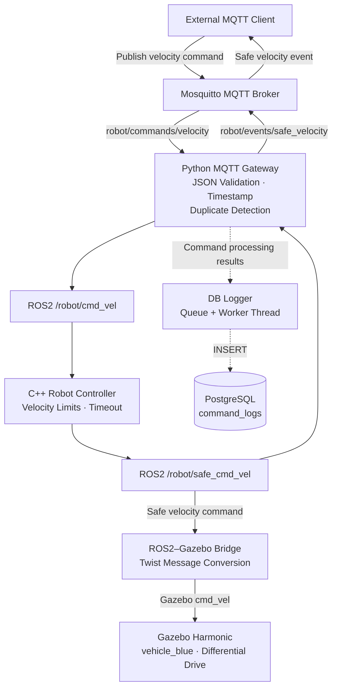

# System Architecture

## ROS2–MQTT Robot Integration Gateway

## Module Responsibilities

- **Mosquitto:** MQTT 명령 및 이벤트 전달
- **Python Gateway:** 메시지 변환, Timestamp 및 중복 명령 검증
- **C++ Controller:** 속도 제한, 비정상 속도 처리, Timeout 정지
- **ROS2–Gazebo Bridge:** ROS2 Twist 메시지를 Gazebo Twist 메시지로 변환
- **Gazebo Harmonic:** Differential Drive 기반 가상 로봇 제어 및 3D 시뮬레이션
- **DB Logger:** 별도 스레드를 통한 명령 처리 기록 저장
- **PostgreSQL:** ACCEPTED, DUPLICATE, REJECTED 기록 보관

## Gazebo Simulation

The existing robot control pipeline is connected to Gazebo Harmonic
through ros_gz_bridge.

The simulated robot receives velocity commands through:

- ROS2 topic: `/robot/safe_cmd_vel`
- Gazebo topic: `/model/vehicle_blue/cmd_vel`

Verified integration flow:

MQTT → Python Gateway → C++ Controller → ROS2–Gazebo Bridge → Gazebo

Integration test results:

- MQTT 명령 10개 정상 처리
- PostgreSQL ACCEPTED 10개 기록
- Gazebo 파란색 로봇 이동 확인
- 명령 중단 후 Timeout 정지 확인

For launch instructions and test details, see
[Gazebo Harmonic Integration](gazebo_integration.md).

## Design Notes

- MQTT QoS 1을 사용하며 명령 중복 가능성을 고려한다.
- ROS2 제어 명령 처리와 DB 저장 작업은 분리되어 있다.
- DB 저장 실패 시 일부 로그가 유실될 수 있다.
- `/robot/safe_cmd_vel`은 측정 속도가 아닌 안전 처리된 제어 명령이다.
- Gazebo의 예제 로봇에는 별도의 속도 및 가속도 제한이 적용된다.
- Gazebo 연동은 실제 로봇 하드웨어 제어가 아닌 시뮬레이션 검증이다.