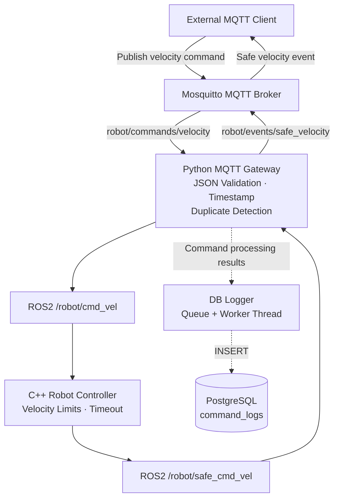

# System Architecture

## ROS2–MQTT Robot Integration Gateway



## Module Responsibilities

- **Mosquitto:** MQTT 명령 및 이벤트 전달
- **Python Gateway:** 메시지 변환, Timestamp 및 중복 명령 검증
- **C++ Controller:** 속도 제한, 비정상 속도 처리, Timeout 정지
- **DB Logger:** 별도 스레드를 통한 명령 처리 기록 저장
- **PostgreSQL:** ACCEPTED, DUPLICATE, REJECTED 기록 보관

## Design Notes

- MQTT QoS 1을 사용하며 명령 중복 가능성을 고려한다.
- ROS2 제어 명령 처리와 DB 저장 작업은 분리되어 있다.
- DB 저장 실패 시 일부 로그가 유실될 수 있다.
- /robot/safe_cmd_vel은 측정 속도가 아닌 안전 처리된 제어 명령이다.
```
